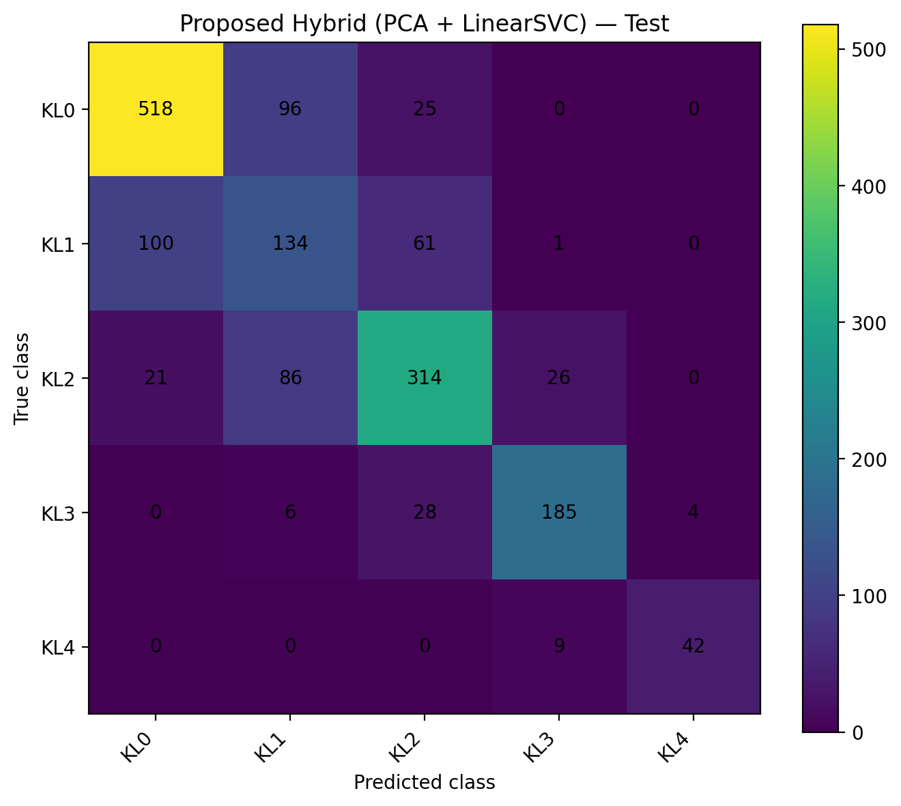

# Knee Osteoarthritis Severity Classification

**Five-class knee osteoarthritis (KOA) grading from knee X-ray images using an ordinal ConvNeXt backbone, PCA, and LinearSVC.**

[](https://www.python.org/)
[](https://pytorch.org/)
[](https://colab.research.google.com/)
[](#at-a-glance)

This repository contains the **current research notebook**, selected result tables, reproducibility notes, and nine archived exploratory notebooks. The proposed pipeline is designed to study whether a compact classical classifier can make effective use of deep image features for ordinal KOA severity grading.

> **Research status:** This is an experimental research project, not a clinically validated diagnostic tool. Results are tied to a particular dataset split, checkpoint, preprocessing pipeline, and scoring procedure; external validation is still required.

## At a glance

- **Task:** classify radiographs into five Kellgren–Lawrence grades, KL0–KL4.
- **Proposed method:** Ordinal ConvNeXt-Small features → PCA → LinearSVC.
- **Feature dimension:** 768 → 59 PCA components, retaining approximately 95.01% of training-feature variance.
- **SVM selection:** Validation Macro F1, with QWK as a secondary tie-breaker.
- **Final evaluation:** 1,656 Test images; the `auto_test` folder is excluded.
- **Reproducibility:** the dataset and model checkpoint are not bundled; instructions are provided below.

## Start here

**Canonical notebook:** [`notebooks/KOA_OrdinalConvNeXt_PCA_LinearSVC_Final.ipynb`](notebooks/KOA_OrdinalConvNeXt_PCA_LinearSVC_Final.ipynb)

[](https://colab.research.google.com/github/hanieh-rezakhani/KOA-Severity-Classification/blob/main/notebooks/KOA_OrdinalConvNeXt_PCA_LinearSVC_Final.ipynb)

The nine notebooks in [`notebooks/historical/`](notebooks/historical/) document earlier experiments. They are archival research artifacts, not alternative versions of the canonical pipeline; their saved cell outputs were cleared during cleanup.

## Proposed pipeline

1. **Load the trained ordinal ConvNeXt-Small checkpoint.** The canonical notebook uses the existing checkpoint; it does not train ConvNeXt from scratch.
2. **Download the dataset.** The notebook uses KaggleHub and pins dataset version 1.
3. **Preprocess images.** Images are resized to 384 × 384 and normalized with ImageNet statistics.
4. **Extract deep features.** The model runs in evaluation mode and produces 768-dimensional features without updating the ConvNeXt weights.
5. **Reduce dimensionality.** PCA is fitted on Train features only. The fitted transform is then applied to Validation and Test features.
6. **Select the SVM.** LinearSVC candidates are fitted on Train features and selected using Validation Macro F1; QWK is used as a secondary tie-breaker. The selected configuration in the recorded run is `C=0.1`, `class_weight="balanced"`.
7. **Evaluate.** Accuracy, Macro F1, Balanced Accuracy, QWK, per-class metrics, and macro one-vs-rest ROC-AUC are reported.
8. **Estimate uncertainty.** Paired cluster bootstrap resamples filename-derived participant clusters while keeping the two laterality images for a sampled identifier together.

ROC-AUC is reported as a complementary discrimination metric. **It is not used to select the SVM hyperparameters.**

## Recorded results

The following values are from the recorded Google Colab run and are also available in [`results/final_test_metrics.csv`](results/final_test_metrics.csv).

### Test-set classification metrics

| Model | Accuracy | Macro F1 | Balanced Accuracy | QWK | Macro ROC-AUC (OvR) |
|---|---:|---:|---:|---:|---:|
| Direct Ordinal ConvNeXt (baseline) | 0.7216 | 0.7266 | 0.7249 | **0.8806** | **0.9279** |
| **Proposed: ConvNeXt features + PCA + LinearSVC** | **0.7204** | **0.7323** | **0.7238** | 0.8654 | 0.9237 |

The proposed hybrid has the higher **Macro F1 point estimate** (0.7323 vs. 0.7266), while the direct baseline has higher QWK and Macro ROC-AUC. The results therefore do **not** show that the proposed method is best on every metric.

### Macro ROC-AUC on Validation and Test

| Split | Direct Ordinal ConvNeXt | Proposed hybrid |
|---|---:|---:|
| Validation | 0.9122 | 0.9078 |
| Test | 0.9279 | 0.9237 |

### Per-class Test ROC-AUC

| KL grade | Test support | Direct baseline | Proposed hybrid |
|---|---:|---:|---:|
| KL0 | 639 | 0.9404 | 0.9354 |
| KL1 | 296 | 0.7954 | 0.7949 |
| KL2 | 447 | 0.9239 | 0.9159 |
| KL3 | 223 | 0.9817 | 0.9804 |
| KL4 | 51 | 0.9981 | 0.9917 |

KL1 has the lowest ROC-AUC among the five grades for the proposed method, consistent with the difficulty of separating early disease grades.

### Paired cluster-bootstrap comparison

The reported intervals use 2,000 paired bootstrap replicates over 828 filename-derived clusters. The intervals are conditional on the saved predictions and this cluster definition.

| Difference (hybrid − baseline) | Point estimate | 95% CI |
|---|---:|---:|
| Accuracy | −0.0012 | [−0.0157, 0.0133] |
| Macro F1 | +0.0057 | [−0.0122, 0.0250] |
| Balanced Accuracy | −0.0012 | [−0.0209, 0.0180] |
| QWK | −0.0152 | [−0.0233, −0.0073] |
| Macro ROC-AUC | −0.0042 | [−0.0080, −0.0007] |

The Macro F1 difference interval includes zero, so the observed point-estimate gain does not by itself establish a clear statistical advantage. The AUC and QWK intervals favor the direct baseline in this run. Interpret the measures together rather than relying on a single score.

### Proposed-model confusion matrix



The confusion matrix and its underlying counts are available in [`results/test_confusion_matrix_hybrid.csv`](results/test_confusion_matrix_hybrid.csv).

## Reproduce the current pipeline

### Requirements

The canonical workflow is designed for **Google Colab**. A GPU is recommended for feature extraction, although the ROC-AUC and bootstrap calculations can run on CPU. The notebook uses PyTorch and torchvision from the runtime plus the extra packages listed in [`requirements.txt`](requirements.txt).

### Steps

1. Open the [canonical notebook](https://colab.research.google.com/github/hanieh-rezakhani/KOA-Severity-Classification/blob/main/notebooks/KOA_OrdinalConvNeXt_PCA_LinearSVC_Final.ipynb) in Colab.
2. Select a GPU runtime if available (**Runtime → Change runtime type → GPU**).
3. Connect the Google Drive that contains the trained checkpoint at:

   ```text
   /content/drive/MyDrive/best_ordinal_convnext.pth
   ```

   The checkpoint is not included in this repository. An author-maintained checkpoint folder is linked [here](https://drive.google.com/drive/folders/1FphXghZ4p0TEZl6UjrPUbVbpQjWQ6njW?usp=sharing); confirm that you have the checkpoint matching the reported run before evaluating results.

4. Run the notebook from top to bottom in a fresh runtime. KaggleHub downloads the pinned dataset version automatically.
5. By default, generated files are written to:

   ```text
   /content/drive/MyDrive/KOA_OrdinalConvNeXt_PCA_SVM_v1_REPRO_TEST
   ```

   This separate output folder helps avoid overwriting earlier artifacts. Change `OUTPUT_DIR` in the notebook if needed.
6. Compare the run with the checkpoints in [`docs/REPRODUCTION_CHECKLIST.md`](docs/REPRODUCTION_CHECKLIST.md). If results differ, investigate the checkpoint, dataset version, preprocessing, class order, software environment, prediction ordering, and output path. Do not tune settings using Test results.

### Dataset

The notebook uses the [Knee Osteoarthritis Dataset with Severity Grading on Kaggle](https://www.kaggle.com/datasets/shashwatwork/knee-osteoarthritis-dataset-with-severity), pinned to KaggleHub handle `shashwatwork/knee-osteoarthritis-dataset-with-severity/versions/1`. Dataset images are not included in this repository.

The recorded split sizes are:

| Split | Images | Role in the current pipeline |
|---|---:|---|
| Train | 5,778 | Fit PCA and train SVM candidates |
| Validation | 826 | Select SVM configuration and report development metrics |
| Test | 1,656 | Final evaluation after configuration selection |
| `auto_test` | 1,526 | Excluded because historical inspection found substantial filename-derived identifier overlap with Test |

### ROC-AUC scoring note

For the proposed hybrid, ROC-AUC is computed from the continuous `LinearSVC.decision_function` scores. For the direct ordinal baseline, four threshold logits are converted to cumulative probabilities and then to class scores. Some rows violate the expected order of cumulative thresholds; isotonic regression is applied to those scores for ROC-AUC calculation only. This score post-processing does not change the saved hard-label predictions. The recorded counts are 92 Validation samples and 217 Test samples. See the notebook's ROC-AUC sections and [`results/README.md`](results/README.md) for details.

## Results and supporting files

The [`results/`](results/) directory contains compact result artifacts from the recorded run:

- `final_test_metrics.csv` — Test classification metrics and Macro ROC-AUC for both methods.
- `validation_roc_auc_summary.csv` and `validation_roc_auc_per_class.csv` — Validation AUC results.
- `test_roc_auc_summary.csv` and `test_roc_auc_per_class.csv` — Test AUC results.
- `test_roc_auc_patient_bootstrap_ci.csv` — paired cluster-bootstrap interval for the Test Macro ROC-AUC estimates and their difference.
- `test_bootstrap_patient_level.csv` — paired cluster-bootstrap intervals for the classification metrics.
- `test_confusion_matrix_hybrid.csv` and `.png` — confusion matrix for the proposed method.

The files are reference artifacts from the recorded run; they are not regenerated merely by packaging the repository.

## Reproducibility and limitations

- The current notebook selects the SVM configuration using Validation and does not fit PCA or LinearSVC on Test.
- The numeric filename prefix is used as a **filename-derived cluster identifier**, and `L`/`R` denotes laterality according to the documented naming convention. These identifiers were not independently verified as clinical patient IDs. Bootstrap intervals are conditional on this grouping and the saved predictions.
- Some earlier exploratory notebooks used Test labels to tune other historical configurations. The current canonical notebook does not do that, but this history means the entire project should not be presented as if every past experiment used one untouched Test set.
- The checkpoint and dataset are not packaged, and the packaging revision itself has not been freshly rerun end-to-end in a clean Colab runtime after the latest notebook organization and artifact-check edits. See [`docs/BUILD_VALIDATION.txt`](docs/BUILD_VALIDATION.txt) and [`docs/REPRODUCTION_CHECKLIST.md`](docs/REPRODUCTION_CHECKLIST.md).
- The proposed method is a research prototype. Independent-dataset validation and clinical evaluation are needed before any real-world clinical use.

## Repository layout

```text
.
├── README.md
├── CITATION.cff
├── requirements.txt
├── .gitignore
├── notebooks/
│   ├── KOA_OrdinalConvNeXt_PCA_LinearSVC_Final.ipynb  # canonical pipeline
│   └── historical/                                  # nine exploratory notebooks
├── results/                                          # reported metrics and confusion matrix
├── docs/                                             # experiment map and reproducibility notes
└── archive/README.md                                 # archive policy
```

This repository intentionally documents the workflow that is actually included. It does not claim to contain a separate `src/` package, command-line training framework, or automated test suite.

## Citation and reuse

Please cite the original dataset and the relevant model/research sources when using this work. The repository includes a starter [`CITATION.cff`](CITATION.cff); update it when a manuscript or preprint has a final citation.

**License:** This snapshot does not currently include a license file. Please contact the repository owner before reusing or redistributing the code.

## Acknowledgment

This work explores a hybrid approach to ordinal medical-image classification, combining deep visual features with dimensionality reduction and a classical classifier. Feedback on reproducibility, evaluation protocols, and class-imbalance handling is welcome.
